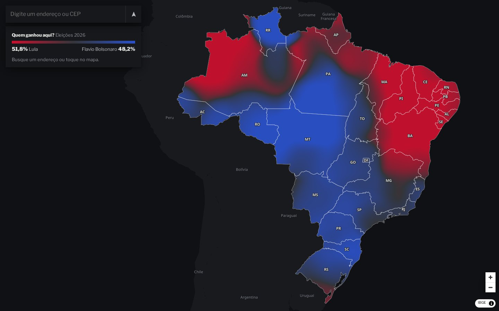

Brazil's electoral court publishes the vote count of every ballot box in the country, for every
race. Most coverage stops at the city, but the question people actually argue about is smaller:
who won around here?

**[Quem ganhou aqui?](https://quemganhou.pealan.dev)** ("Who won here?") answers it. The site opens
at your location, if you allow it, or at any address or postcode you type, and shows the result of
the 2026 general election for president, governor, senator, and federal and state deputies. The
default view is your neighbourhood, with the polling place, electoral zone, city, state and country
a tap away, all over a continuous red-to-blue surface of the whole country.



## Goals and constraints

Four requirements shaped the design, and most of the interesting decisions come from holding them
at the same time:

- **Street-level granularity.** The unit of the map is the polling place, of which there are
  more than 90,000, not the municipality.
- **No backend.** Published results rarely change, so the site is static: no database server, no
  API keys, no cookies, and near-zero marginal cost on a small shared AWS instance.
- **A map that stays fluid.** Every polling place has to be drawn at once, on ordinary phones and
  integrated GPUs, with no gaps anywhere in the country.
- **Safe to share.** A link is the natural unit of distribution for a site like this, so it has to
  preview well and must never reveal where the person sharing it was standing.

## Data: from ballot boxes to six levels of rollup

The source is about 3 GB of zipped files from the TSE, the electoral court, at the level of the
voting section (one ballot box). They are Latin-1, `;`-separated CSVs with their own conventions:
coordinates use decimal commas and `-1` for "unknown", vote number 95 is a blank ballot, 96 and 97
are null votes, and two-digit numbers in deputy races are votes for a party, which count as valid
but must not be ranked as candidates.

Since the site is read-only, everything is precomputed. A DuckDB pipeline loads each file and
aggregates to the polling place immediately, so section-level rows are never stored. Window
functions then rank the top candidates per race at six levels: polling place, neighbourhood, zone,
city, state and country. The load takes about 18 minutes under a 2 GB memory limit, spilling to
disk, and stays cached in the DuckDB file, so later stages rerun without it.

The output is one JSON shard per municipality, 5,571 in all. The check that matters most is
reproducing a known number from raw data: the national runoff, rebuilt from section-level rows,
gives **Lula 51.78%, Flávio Bolsonaro 48.22%**. Of 94,539 polling places, 92,965 have usable
coordinates, and those are what the map draws.

The data has one trap worth noting. The candidate status field holds only the final outcome, so a
runoff loser reads "not elected" on the first-round results as well. Whether a candidate went to
the runoff has to be inferred from the presence of second-round results.

## Rendering: a surface, not dots

Election maps often draw Voronoi cells around polling places, which implies hard boundaries that
don't exist. This map uses a smooth surface instead: each polling place contributes a Gaussian
kernel, and each pixel shows the vote-weighted margin between the two leading candidates.

Computing that on a CPU canvas is too slow to follow the camera, so the surface is a WebGL2 custom
layer inside MapLibre, which puts it in the map's own frame and keeps it locked to the camera
during a pinch. It renders in two passes:

1. **Splat.** Instanced quads with additive blending write into a half-float texture: Σ g·w in red,
   Σ g·w·margin in green, Σ g in blue.
2. **Colour.** A full-screen pass divides the channels, which gives a true weighted average at each
   pixel:

```glsl
vec4 f = texture(tex, uv);
float m = f.y / f.x;                        // vote-weighted margin here
float t = pow(min(1., abs(m) / .4), .75);   // saturates at a 40-point margin
vec3 c = mix(N, m >= 0. ? A : B, t);        // neutral means close
```

Kernel width comes from the distance to the third-nearest neighbour, computed in the pipeline with
a grid index, clamped, and stored as a log-scaled byte. Dense cities stay sharp and the interior
stays continuous.

**Keeping it fast.** Splatting 93,000 kernels every frame leaves no headroom on an integrated GPU:
at 1440×900 on an Intel UHD, forced frames sat around 15 ms with spikes to 52 ms. So the splat is
treated as a cached result rather than a per-frame cost. It renders into a texture 1.6× the
viewport, and each frame only resamples that texture for the current camera, redrawing when the
camera drifts too far or comes to rest. Level of detail covers the rest: below zoom 6.2
municipalities stand in for polling places, and below zoom 9 the splat runs at half resolution. A
regression test reads a splat counter to prove that panning doesn't re-splat.

<div class="compare">
  <figure>
    <figcaption>Zoom 5: regions</figcaption>
    
  </figure>
  <figure>
    <figcaption>Zoom 8: towns</figcaption>
    
  </figure>
</div>

**Staying under the water.** The surface sits below water and roads, so the coastline comes from
the map, not from the data. This depends on a MapLibre detail: fully opaque fills draw in an
earlier pass than custom layers, whatever their order in the layer list, so a surface placed under
opaque water still paints over it. Giving water and the masks an opacity of `.999` moves them into
the later pass and makes the layer order hold.

**No holes.** Kernels are local, so a region far from any polling place could have no colour at
all. To prevent that, every municipality also carries a wide kernel at a weight of 0.002. Near a
polling place it is negligible. Where none reaches, deep in the Amazon for example, it is the only
contribution, and because the output is a weighted average, it still gives the right colour.

## A basemap built for one job

General-purpose map styles compete with the data: rivers and roads outweigh state lines, and the
national view pulls in large tiles full of detail nobody needs. The site therefore has its own
dark style with a clear hierarchy: the surface first, then state lines, then only as much geography
as the zoom calls for.

Below zoom 7, everything drawn comes from a single GeoJSON file generated from IBGE (national
statistics office) boundaries: states, a sea mask, neighbouring countries and Portuguese labels.
MapLibre skips the source of a layer hidden at the current zoom, so the national view requests
**zero tiles**, confirmed by counting requests on the live site. That is why zooming out is
instant. Vector tiles from OpenFreeMap, which needs no API key, add detail from zoom 7 up.

## Delivery

With no server to query, payload size is the performance budget. Three techniques keep it small:

- **Binary columns.** Map data is delta-coded 16-bit coordinates plus byte-sized margins and vote
  weights, inflated in the browser with `DecompressionStream`. First paint needs 57 KB for
  municipalities, and every polling place in the country adds about 520 KB.
- **Payload splitting.** Per-place votes live apart from the default shard, because the
  neighbourhood view never reads them. That takes São Paulo, the largest shard, from 759 KB to
  381 KB over the wire.
- **Service worker.** Code and data are served from cache and refreshed in the background, so
  repeat visits skip the round trips. Pages stay network-only.

Geocoding also happens in the browser: Photon for type-ahead, Nominatim as a fallback, and
BrasilAPI for postcodes. The typed address never reaches my server, though those services do
receive it.

## Privacy and shareable links

Putting state in the URL hash is the obvious approach for a static site, and here it would be a
privacy bug. A hash holding coordinates means that sharing a result found through "use my location"
publishes where you are.

So links carry an area, never a position. About 57,000 statically generated pages, such as
[`/sp/sao-paulo/pinheiros/`](https://quemganhou.pealan.dev/sp/sao-paulo/pinheiros/), have their own
title and Open Graph tags, because crawlers never see a hash. Fragments for a polling place or zone
must match strict patterns, the site ships a default-deny Content Security Policy, and a regression
test feeds in a link carrying an `onerror` payload. The last known location stays in the visitor's
own browser, rounded to about 100 metres.


The interface is also explicit about what the data can't say. The open data doesn't link addresses
to voter registrations, so the site describes the nearest polling place, not necessarily yours, and
it labels the surface as a smoothed estimate rather than real boundaries.

## Building it with an AI agent

The site was built with Claude Code, with the agent doing the implementation and me setting
direction, reviewing the result and deciding what shipped. Three practices made that work:

- **Context lives in files.** A short router-style `CLAUDE.md`, a data contract between pipeline
  and frontend, and a dated work diary of decisions and dead ends mean any new session can resume
  cold.
- **Reusable infrastructure.** Site provisioning is one idempotent command, and the project
  structure is a template, so the next project starts from the same base.
- **Verification is automated.** An agent saying "done" is not evidence. Playwright drives desktop
  and real phone emulation against the deployed site, reads pixels back from the GL canvas to
  measure how much land is painted, and checks coverage in locations far from any large city.

The review loop matters as much as the tooling. The site's main design decisions, a full-screen map
with one answer on it and a basemap built for the data, came from using the product and judging it
as a reader would. The agent was then fast at finding causes and building fixes.


The result is a national, street-level election map served entirely from static files. Try your
own street: **[quemganhou.pealan.dev](https://quemganhou.pealan.dev)**.
