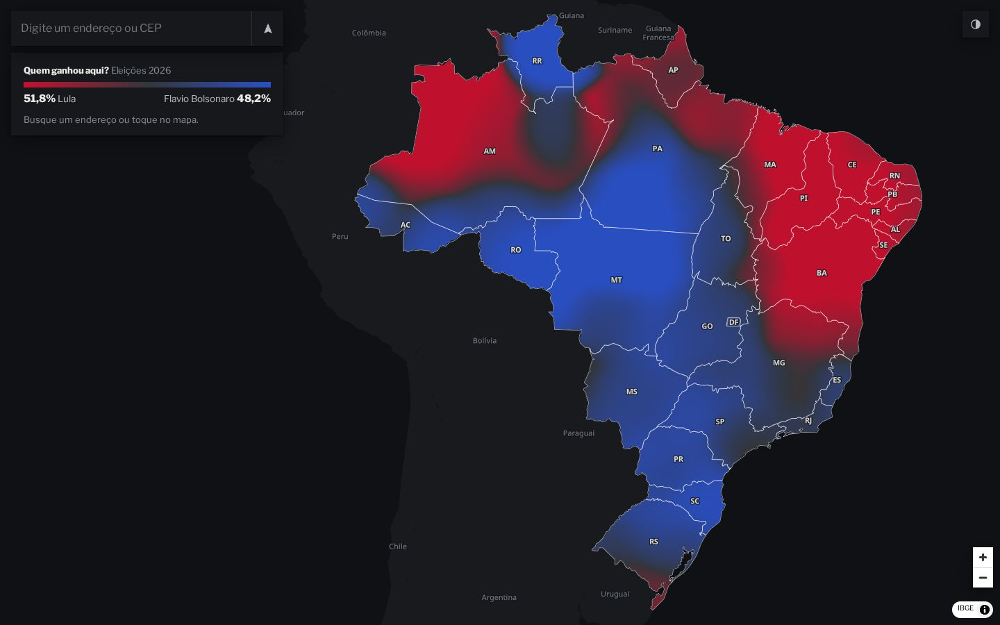
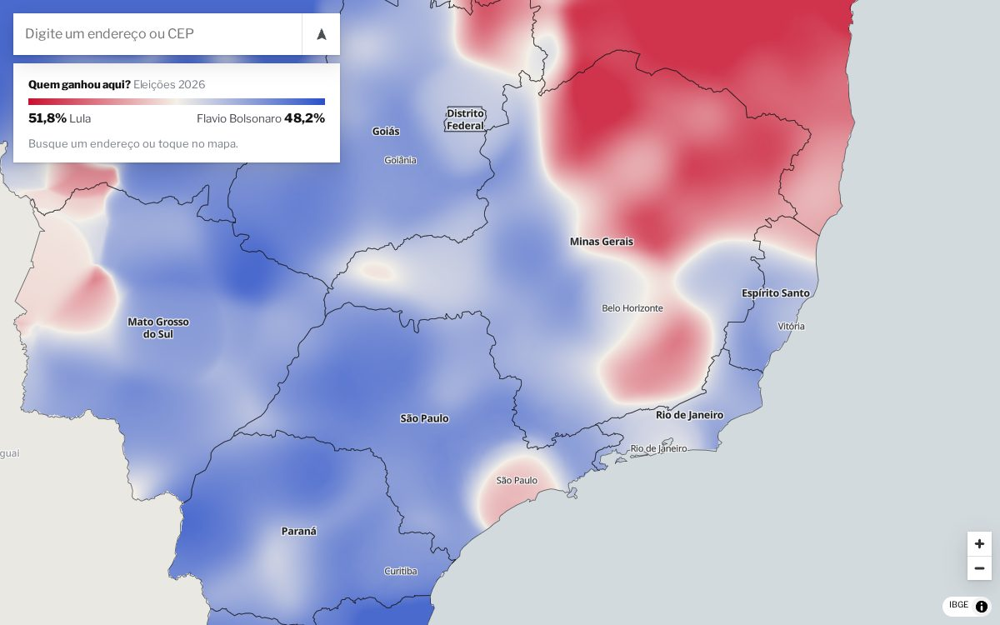
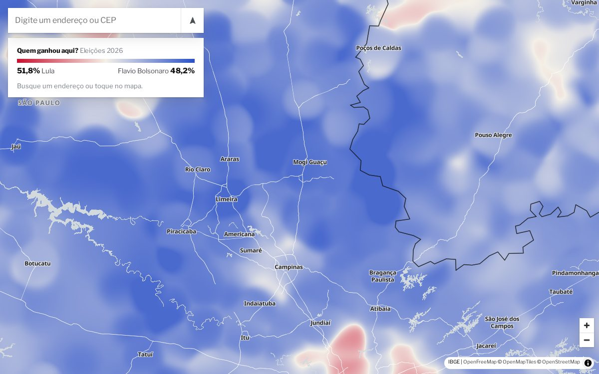
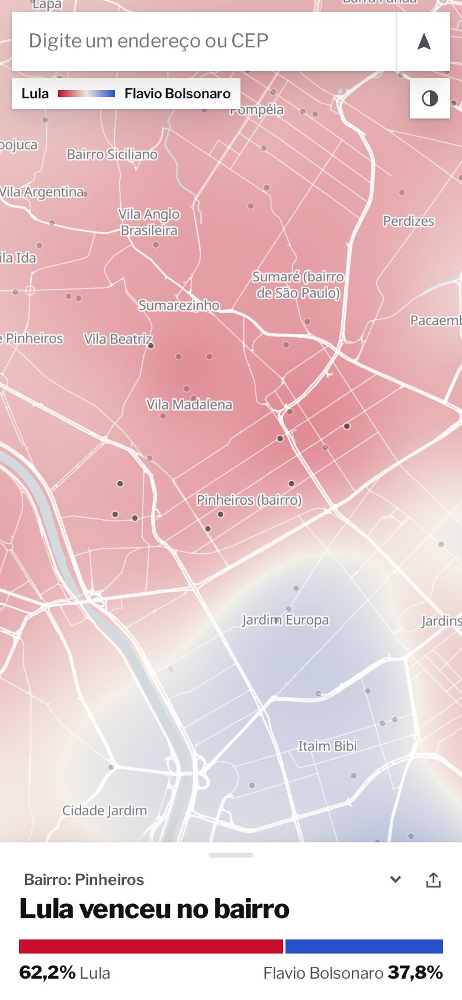
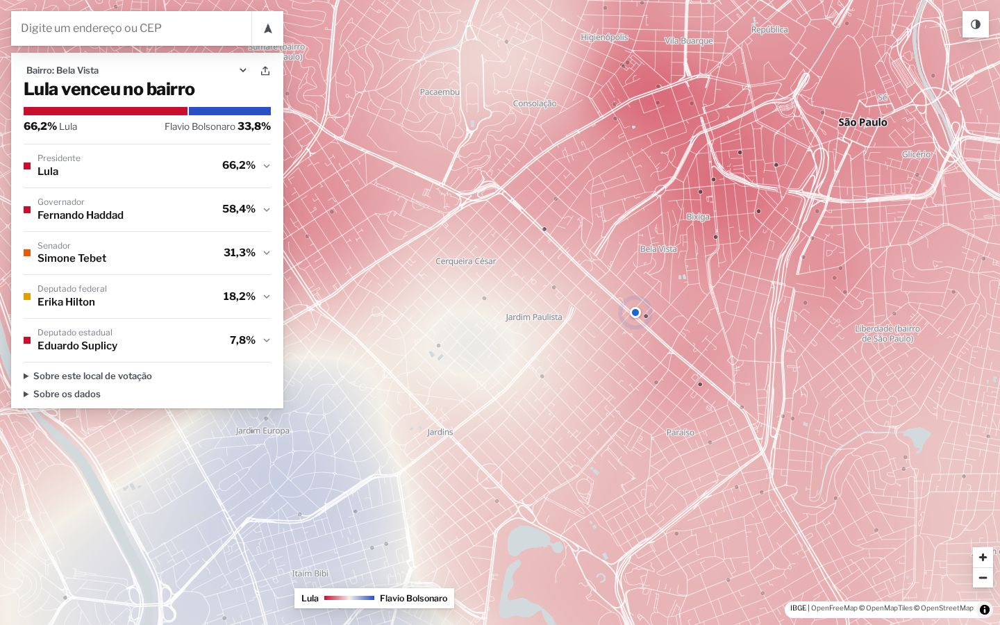

**[Quem ganhou aqui?](https://quemganhou.pealan.dev)** ("Who won here?") opens at your location,
if you allow it, and answers one question: who won the 2026 Brazilian general election around you.
It covers president, governor, senator, and federal and state deputies, for your neighbourhood,
polling place, electoral zone, city, state and country, over a continuous red-to-blue surface of
the whole country.



The hard part is the combination. The source is about 3 GB of zipped electoral data at ballot-box
level. The site has no backend, no API keys and no cookies, at near-zero marginal hosting cost. And
the map has to stay smooth while drawing every polling place in a country of 5,571 municipalities.

I built it with Claude Code. This post covers the engineering, then how I directed the agent,
including what it got wrong.

## Data: ballot boxes to six levels of rollup

The electoral court (TSE) publishes the count of every voting section for every race. The files
are Latin-1, `;`-separated CSVs. Coordinates use decimal commas and `-1` for "unknown". Vote number
95 is blank, 96 and 97 are null, and two-digit numbers in deputy races are party votes that count
as valid but must not be ranked as candidates.

The site is read-only, so everything is precomputed. A DuckDB pipeline loads each file and
aggregates to the polling place immediately, so section rows are never stored. Window functions
then rank the top candidates per race at six levels: polling place, neighbourhood, zone, city,
state and country. The load takes about 18 minutes under a 2 GB memory limit, spilling to disk, and
stays cached in the DuckDB file so later stages can rerun without it.

The output is 5,571 municipality shards. The check I trust most: the national runoff, rebuilt from
raw section data, gives **Lula 51.78%, Flávio Bolsonaro 48.22%**. Of 94,539 polling places, 92,965
have usable coordinates, and those are what the map draws.

One trap: the candidate status field holds only the final outcome, so a runoff loser reads "not
elected" on the first-round results too. "Went to the runoff" has to be inferred from the
second-round data.

## Rendering: a surface, not dots

Election maps often use Voronoi cells around polling places. I wanted a gradient instead: each
polling place contributes a Gaussian kernel, and the map shows the vote-weighted margin between
the two leading candidates.

The first version computed this on a canvas and redrew on `moveend`. It was slow, kept the old
picture during a pinch, and had holes. So it moved to WebGL2, as a custom layer inside MapLibre,
in two passes:

1. **Splat.** Instanced quads with additive blending write into a half-float texture: Σ g·w in red,
   Σ g·w·margin in green, Σ g in blue.
2. **Colour.** A full-screen pass divides the channels, giving a true weighted average per pixel:

```glsl
vec4 f = texture(tex, uv);
float m = f.y / f.x;                        // vote-weighted margin here
float t = pow(min(1., abs(m) / .4), .75);   // saturates at a 40-point margin
vec3 c = mix(N, m >= 0. ? A : B, t);        // neutral means close
```

Kernel width comes from the distance to the third-nearest neighbour, computed in the pipeline with
a grid index, clamped, and stored as a log-scaled byte. Dense cities stay sharp and the interior
stays continuous.

**Performance.** Running inside the map's frame fixed the lag, but forced frames on an integrated
Intel GPU at 1440×900 had a median of about 15 ms with spikes to 52 ms at national zoom. That left
no headroom, because all 93k kernels were splatted every frame. So the splat now renders into a
cached texture 1.6× the viewport, and each frame only resamples it for the current camera. It
stays anchored during a pinch and redraws when the camera drifts too far or comes to rest. Level
of detail does the rest: below zoom 6.2 municipalities stand in for polling places, and below zoom
9 the splat runs at half resolution. A test reads a splat counter to prove that panning doesn't
re-splat.

<div class="compare">
  <figure>
    <figcaption>Zoom 5: regions</figcaption>
    
  </figure>
  <figure>
    <figcaption>Zoom 8: towns</figcaption>
    
  </figure>
</div>

**The render-pass gotcha.** The surface sits under water and roads, so the coastline comes from the
map. But it painted straight over the water. MapLibre draws fully opaque fills in an earlier pass
than custom layers, whatever their order in the layer list. The fix is one number: water and the
masks use opacity `.999`, which moves them into the later pass.

**No holes.** Every municipality also carries a wide kernel at a weight of 0.002. Near a polling
place it is negligible. Where none reaches, deep in the Amazon for example, it is the only
contribution, and the weighted average still gives the right colour. The earlier version dropped
municipalities when zoomed in, which caused the gaps.

## A basemap built for one job

Off-the-shelf styles fought the data: rivers and roads looked stronger than state lines, and the
national view pulled in large tiles full of detail nobody needed. So I replaced them with one layer
list and two palettes. Below zoom 7, everything drawn comes from a GeoJSON file generated from IBGE
(national statistics office) boundaries: states, a sea mask, neighbouring countries and our own
Portuguese labels.

A layer hidden at the current zoom makes MapLibre skip its source, so the national view requests
**zero tiles**. I confirmed that by counting requests on the live site, and it is why zooming out
is instant.

## Delivery

- **Binary columns.** Map data is delta-coded 16-bit coordinates plus byte-sized margins and vote
  weights, inflated in the browser with `DecompressionStream`. First paint needs 57 KB for
  municipalities. Every polling place adds about 520 KB.
- **Payload split.** Per-place votes moved out of the default shard, since the neighbourhood view
  never reads them. São Paulo dropped from 759 KB to 381 KB over the wire.
- **Service worker.** Code and data come from cache and refresh in the background, so repeat visits
  skip the round trips. Pages stay network-only.

## Privacy and links

My first URL design was wrong. The hash held exact coordinates and free text, so sharing a result
found through "use my location" published where you were standing.

Links now carry an area, never a position. About 57,000 statically generated pages, such as
[`/sp/sao-paulo/pinheiros/`](https://quemganhou.pealan.dev/sp/sao-paulo/pinheiros/), have their own
title and Open Graph tags, because crawlers never see a hash. Fragments for a polling place or zone
must match strict patterns, and the site ships a default-deny Content Security Policy. Old links
still open: coordinates are strictly parsed, the text is ignored, and the URL is rewritten on
arrival. A regression test feeds in a legacy link carrying an `onerror` payload.



The interface is honest about its limits. The open data doesn't link addresses to voter
registrations, so the site says this is the nearest polling place, not necessarily yours. The
surface is labelled as a smoothed estimate, not real boundaries.

## How I directed the agent

The first brief was one paragraph: the site, the races, use my existing setup, depend on me as
little as possible. What followed is why I trust this way of working:

- **It read before writing**, starting from my latest project's structure. HEAD requests against
  the guessed TSE paths confirmed that both rounds were published, and sized each file, before any
  pipeline existed.
- **It generalised instead of copying.** Site provisioning became one idempotent command, and the
  project structure became a template.
- **Context lives in files.** A short router-style `CLAUDE.md`, a data contract, and a dated work
  diary recording decisions, dead ends and what each change reverses. A new session can resume cold.

The first version worked and looked generated. The quality came from review rounds, and those were
mine. "Too much information on the screen" turned a split-panel app into a full-screen map.
"Slow, keeps the old shape, missing in some areas" drove the GPU layer. Rivers stronger than state
lines produced the custom basemap. The architecture went from Leaflet canvas to GPU layer to owned
basemap because I used the thing and said what was wrong. The agent found causes and built fixes
far faster than I could have.

Real bugs, found by measuring and looking:

- **Water.** The render-pass issue above, caught by looking at the rendered map.
- **English in dark mode.** The Portuguese label override matched one style's layer ids only, so
  the dark style showed English names. The basemap now has one layer list for both themes.
- **The missing legend.** `syncSurface` returned early when the surface hadn't changed, so a result
  arriving after the landing surface never revealed the legend. Share links hid the bug, because
  there the document arrives first. A test now covers a phone that locates itself after load.

I don't take an agent's "done" as evidence, so verification is automated. Playwright drives desktop
and real phone emulation against the deployed site, reads pixels back from the GL canvas to measure
how much land is painted, and checks coverage in five locations that used to be blank. The same
rule applies to the agent's notes: one diary entry said São Paulo had dropped to 309 KB, measuring
the real response gave 381 KB, and the diary was corrected.



## What I'd do next

- Add 2022 to show the swing per polling place: same pipeline, different year.
- Generate a preview image per area. Link cards have their own text but share one national image.
- Measure real frame timing on low-end phones. My numbers come from forced frames on one integrated GPU.

Try your own street: **[quemganhou.pealan.dev](https://quemganhou.pealan.dev)**.
