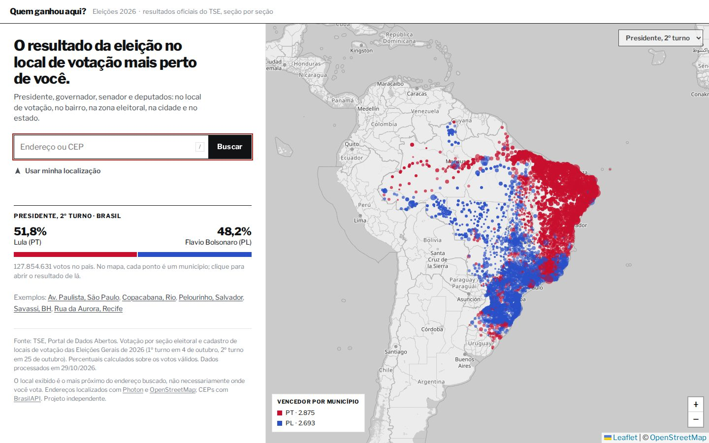
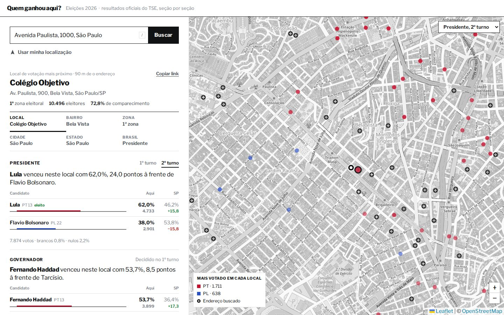
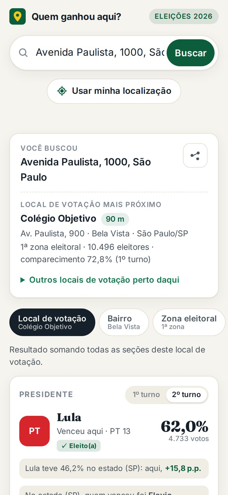
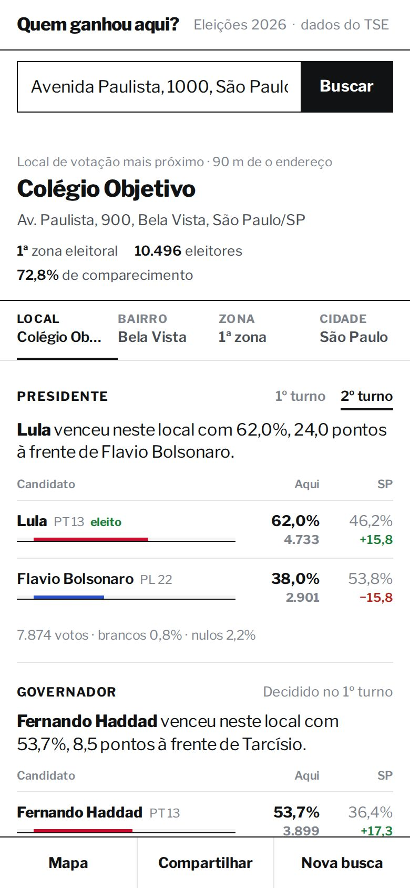

Brazil's electoral court (TSE) publishes the vote count of **every single ballot box**, for
every race. The 2026 general election finished its runoff on 25 October; by the 26th the
files were on the TSE CDN.

Results coverage usually stops at the city. I wanted the question people actually ask when
they argue at the bakery: *who won here, on my street?* So I built
**[quemganhou.pealan.dev](https://quemganhou.pealan.dev)** ("who won here?"): type an
address or a CEP (Brazilian postcode), or share your location, and it finds the nearest
polling place and shows president (both rounds), governor (both rounds), senator, federal
and state deputy for that place, its neighbourhood, its electoral zone, the city, the state
and the country.


This post covers two things: the data engineering, and how I used an AI coding agent
(Claude Code) to do most of the build, including where the agent was *blocked on purpose*.

## The data

Everything comes from the [TSE open-data portal](https://dadosabertos.tse.jus.br/):

| File | What's in it | Size |
|---|---|---|
| `votacao_secao_2026_<UF>.zip` ×27 | votes per **section** (ballot box) for governor, senator, deputies | SP alone: 808 MB zipped |
| `votacao_secao_2026_BR.zip` | president, both rounds, every section | 242 MB |
| `eleitorado_local_votacao_2026.zip` | every polling place: neighbourhood, postcode, **lat/lon**, voters per section | 167 MB |
| `consulta_cand_2026.zip` | candidates: ballot name, party, final outcome | 3 MB |

About **3 GB of zips**. The CSVs are `;`-separated and Latin-1 encoded; coordinates use a
decimal comma, and `-1` means "unknown". Vote number 95 is a blank ballot, 96 is a null
vote, and two-digit numbers in the deputy races are votes for a party rather than a person.

## The pipeline: one DuckDB file, three stages

I didn't want a database server for a read-only site, so the whole thing is precomputed.
`pipeline/build.py` is about 250 lines of Python driving DuckDB:

1. **Load.** Stream each zip member to disk, `read_csv(..., encoding='latin-1')`, and
   immediately `GROUP BY` polling place: `(state, municipality, zone, place, race, round,
   candidate)`. Section-level rows never get stored; only the rollup does. Then join in
   polling-place metadata (neighbourhood, coordinates) and candidate metadata.
2. **Rank.** For each geographic level (place → neighbourhood → zone → city → state →
   Brazil), compute totals (blank, null, valid votes) and the top-N candidates per race with
   a window function:

   ```sql
   select * from (
     select *, row_number() over (
              partition by uf, mun, zona, loc, t, cargo order by votos desc) rk
     from (select uf, mun, zona, loc, t, cargo, sq, num, sum(votos) votos
           from vv where sq > 0 group by all))
   where rk <= :top_n   -- 5–6 per race for a polling place, 8–15 for larger areas
   ```

3. **Export.** One JSON shard per municipality, plus one per state and an index of
   municipality centroids. Candidate metadata is deduplicated into a per-file array, and
   results reference it by index.

On a WSL box with 3 GB of RAM (`memory_limit='2GB'`, spilling to disk):

| Stage | Time |
|---|---|
| Download 28 zips (6 in parallel) | ~2 min |
| Load + roll up (São Paulo alone: 4.5 min) | ~18 min |
| Rank, 6 levels | ~5 min |
| Export 5,571 shards | ~2 min |

Output: **5,571 municipality files, 112 MB**. The largest, São Paulo city, has 2,058
polling places and weighs 1.8 MB raw, **~760 KB over the wire** with nginx gzip. A small
town is a few KB.

Sanity check: the national runoff comes out at **Lula 51.78% vs Flávio Bolsonaro 48.22%**
of valid votes. That number is reproduced from the raw section data, not copied from a
results page.

## The site: static, no keys, no backend

- **Hosting:** a static folder on the AWS `t4g.nano` that already serves my other side
  projects. Marginal cost of one more site: roughly zero.
- **Address → coordinates, in the browser:** [Photon](https://photon.komoot.io) for
  type-ahead, Nominatim as a fallback, and [BrasilAPI](https://brasilapi.com.br) for
  postcodes. No API keys and no cookies, and the typed address never reaches my server,
  which only serves static files. Those third-party services do receive it.
- **Coordinates → polling place:** load the index of municipality centroids (~115 KB gzip),
  fetch the 5 nearest municipality shards, run a haversine over their polling places, and
  pick the nearest. Loading several shards handles addresses near a city border.
- **Map:** Leaflet, with one dot per polling place coloured by the winner. Before you
  search, the landing page shows one dot per municipality (5,571) coloured by the runoff
  winner, from two extra fields in the index.
- **Shareable state:** coordinates, place and scope live in the URL hash.





One honesty point in the UI: the site shows the **nearest** polling place, not *your*
polling place. The open data doesn't link addresses to voter registrations, and the page
says so.

## The agentic part

I gave the agent one paragraph: the site, the races, "use the infrastructure already in
place in WSL, check the latest project to understand the agentic structure and generalize
it, depend on me as little as possible."

What it did, in order:

1. **Read before writing.** It found my `~/deploy-kit` (a playbook plus scripts for my shared
   box), the router-style `CLAUDE.md` of my most recent project (a docs table, working
   rules and status), its append-only `WORK_DIARY.md`, and its `/handoff` skill that moves
   session knowledge into files before the session ends.
2. **Probed the data source** with `curl -I` against the guessed CDN paths before writing
   any pipeline, which confirmed that both rounds were published and sized each file.
3. **Built the pipeline, the site, and the project scaffolding** (router `CLAUDE.md`, a
   `data-refresh` operator agent, a `docs/data.md` with the JSON contract between pipeline
   and frontend).
4. **Generalized the infra** instead of copy-pasting it:
   - `new-static-site.sh <label>`: DNS, a per-site deploy key that can only `rsync` into
     its own docroot, the nginx vhost (now with gzip) and TLS, in one idempotent command.
   - `project-template/`: the router + diary + handoff skeleton for the next project.
   - A guard in the provisioning script. Re-running it used to overwrite the nginx vhost,
     which silently drops the HTTPS block that certbot adds. Now it refuses unless forced.

### Where it stopped, on purpose

The agent runs with a permission classifier. It was **blocked twice**:

- **Changing shared infra.** Creating the DNS record and editing the SSH allowlist on the
  security group touch a box that hosts other sites. The agent finished everything else,
  then asked me for a single command. I approved it, and it ran.
- **Pushing to GitHub.** Classified as a public data-sharing upload. It stopped again until
  I said yes.

That's the division of labour I want: the agent does the build, I hold the keys to anything
shared or public.

### Bugs it hit (and fixed)

- **CARTO basemaps now require an API key.** The first map rendered "API KEY REQUIRED"
  across every tile. It switched to standard OpenStreetMap tiles with a CSS
  `grayscale()`/`invert()` filter so the party colours carry the meaning.
- **The candidate status field only holds the final outcome.** A runoff loser reads "not
  elected" on the first-round card too, so the "went to the runoff" tag can't come from
  that field. It's inferred from the presence of the candidate in the state-wide
  second-round result instead.
- **DuckDB: "Cannot mix aggregates with non-aggregated columns."** A `row_number() over
  (order by sum(votos))` inside a `GROUP BY ALL` query. The fix was to aggregate in a
  subquery and window over the result. The loaded tables were cached in the DuckDB file,
  so the rerun skipped the 18-minute load.
- **SSH "Host key verification failed"** on the first real run of the new provisioning
  script. `known_hosts` knew the box by hostname, not by IP. It's a one-line fix, and it
  only showed up because the script finally ran against production.

## Second pass: making it not look AI-generated

The first version worked, but it looked like what it was: a generated landing page. It had
a centered serif headline with one highlighted word, pill-shaped chips, a stack of
identical shadowed cards, square party badges, and Inter plus Fraunces. My feedback was one
line: make it professional, give desktop and mobile their own UX, and don't be cliché.

The redesign borrows from newspaper results desks instead of SaaS templates:

- **Tables, not cards.** Each race is one plain-language sentence (in Portuguese on the
  site; roughly "Lula won here with 62%, 16 points above his state result" for Av. Paulista)
  followed by a table: candidate, share *here*, share
  *in the state*, and the difference in percentage points. The comparison was always the
  interesting part; now it's the layout.
- **Ink on paper.** Libre Franklin with tabular figures, hairline rules instead of
  shadows, no border radius, and colour only where it encodes a party.
- **Data on the landing page, not copy.** Before you search you see the national runoff
  split and the dot map of all 5,571 municipalities.

Desktop and mobile now get different layouts, not one layout squeezed:

- **Desktop** is a split app. A 480 px results panel scrolls on its own, the map fills the
  rest of the screen, the scope tabs (place / neighbourhood / zone / city / state /
  country) stick at the top of the panel, and `/` focuses the search box.
- **Mobile** is one column. The search box and scope tabs stick to the top, and a bottom
  bar (Map / Share / New search) sits in the thumb zone. The map opens full screen on
  demand. The inline landing map has dragging disabled, so a swipe scrolls the page instead
  of getting trapped panning the map. Share uses the native share sheet.

Testing at 375 px caught bugs a desktop review wouldn't:

- The results table overflowed the screen at 375 px. It now uses `table-layout: fixed`.
- The "your address" pin was red, the same colour as PT's dots. It's now an ink ring.
- PL's navy dots disappeared on the dark-mode map, so the colour was brightened.
- A shared link with a scope but no polling place ignored the scope.

All of it was checked in a browser at desktop width (light and dark) and at 375 px, with no
horizontal overflow and no console errors.

The same address, before and after:

<div class="compare">
  <figure>
    <figcaption>First version</figcaption>
    
  </figure>
  <figure>
    <figcaption>Redesign</figcaption>
    
  </figure>
</div>

## Timeline of the first version (from log timestamps)

| | Local time |
|---|---|
| Request | ~01:15 |
| First TSE download | 01:20 |
| Full build done (5,571 shards) | 01:48 |
| Site tested locally and committed | 01:51 |
| *(a few minutes waiting for my approval to touch shared infra)* | |
| Live over HTTPS, smoke-tested | ~01:58 |
| Code pushed to GitHub, after a second approval | 02:35 |
| Redesign live | ~02:44 |

About **35 minutes of agent work** to a locally verified site, and about 45 minutes from
request to live. *(The request time is an estimate; the others come from logs and commits.)*
The redesign followed in a second pass, while a parallel agent session drafted this post.

## What I'd do next

- Add 2022 to show the swing per polling place: same pipeline, different year.
- Trim the shards (shorter keys, drop the postcode field) to cut the São Paulo payload.
- Move admin SSH to AWS SSM Session Manager so no allowlist needs updating at all.

The site is live at [quemganhou.pealan.dev](https://quemganhou.pealan.dev). Try your own street.
